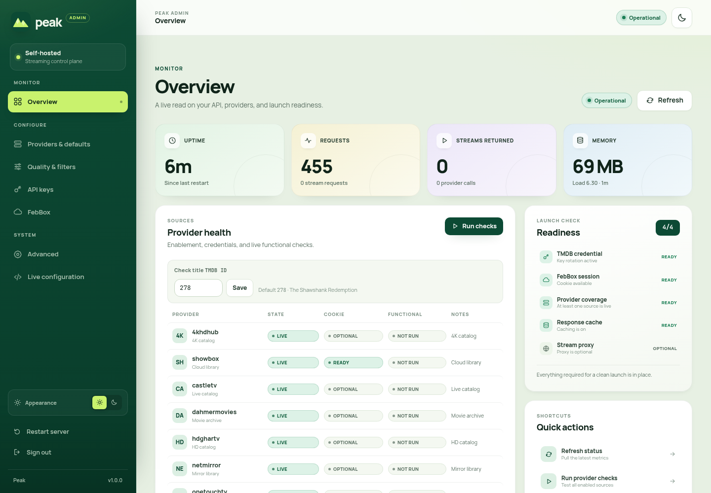
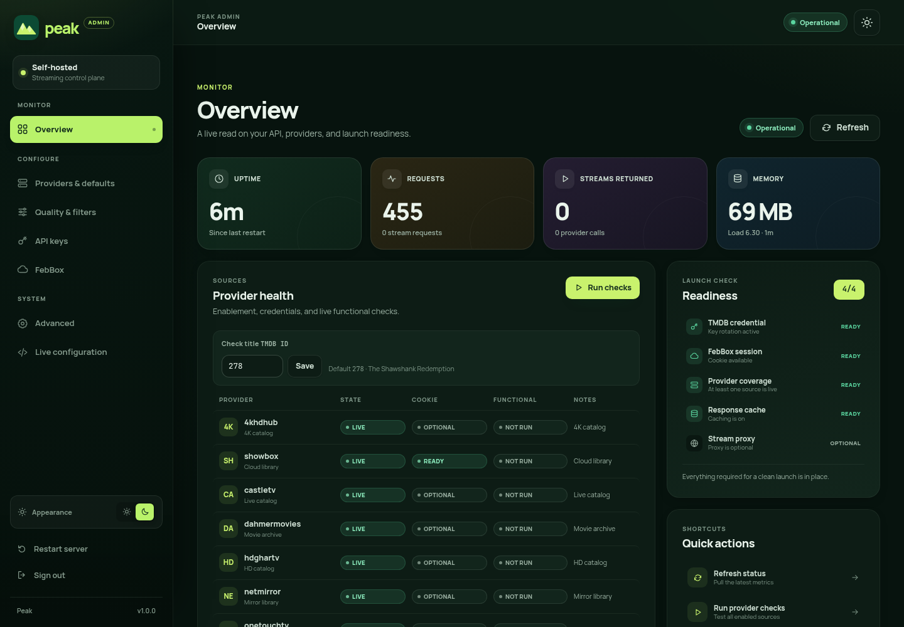
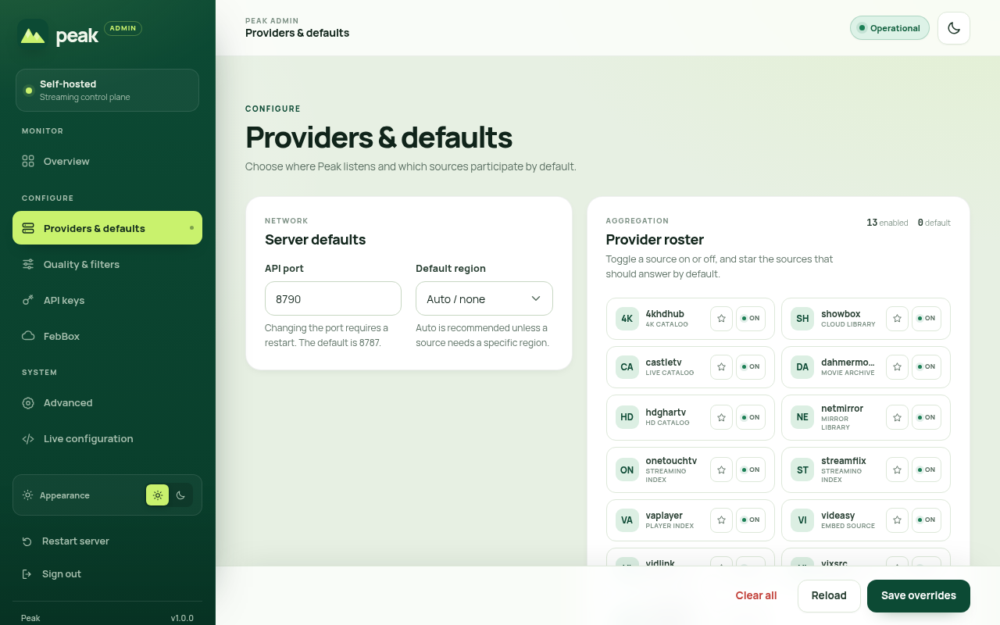
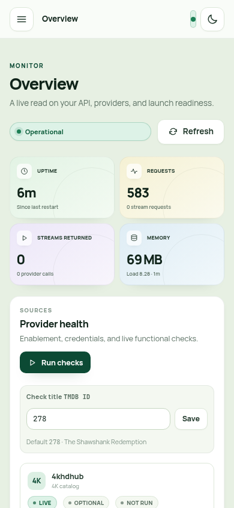

<p align="center">
  
</p>

<h1 align="center">Peak</h1>

<p align="center">
  A self-hosted streaming source aggregation API with a polished admin portal.
</p>

<p align="center">
  
  
  
</p>

---

## Overview

Peak turns TMDB IDs into playable streams. It aggregates 13 built-in providers, applies quality and codec filters, and exposes a clean JSON API. A self-hosted admin portal gives you live metrics, provider health checks, runtime configuration, and secure access without editing files by hand.

The API and admin portal are a single Node.js service with no build step for the UI.

## Screenshots

| Light | Dark |
| --- | --- |
|  |  |

| Providers | Mobile |
| --- | --- |
|  |  |

More screenshots are available in [`screenshots/`](screenshots).

## Features

- **13 providers** — Showbox/FebBox, 4KHDHub, VixSrc, Videasy, Vidlink, DahmerMovies, StreamFlix, VaPlayer, CastleTV, HDGharTV, NetMirror, OneTouchTV, and ZXCStreams.
- **Aggregated streams** — Query one TMDB ID and receive normalized streams from every enabled provider.
- **Provider controls** — Enable or disable providers, choose defaults, and run functional checks from the dashboard.
- **TMDB key rotation** — Add multiple TMDB API keys and rotate them per request.
- **Quality and codec filters** — Use presets or custom JSON to control minimum quality and exclude DV/HDR sources.
- **Runtime configuration** — Change port, region, providers, keys, cookies, cache, validation, and proxy settings without a restart.
- **Optional stream proxy** — Route HLS playlists, segments, and subtitles through Peak to normalize headers and avoid browser CORS issues.
- **Secure admin** — PBKDF2 password hashing, HttpOnly sessions, login rate limiting, and password changes.
- **Health and metrics** — Uptime, request counts, stream counts, provider timings, and memory usage.
- **Responsive admin portal** — Rebuilt dashboard and settings panels with light and dark themes, keyboard support, and a mobile drawer.
- **No frontend build pipeline** — The admin portal is hand-crafted HTML, CSS, and JavaScript served directly by Express.

## Requirements

- Node.js 18 or newer
- A TMDB API key
- Optional: FebBox JWT cookie for Showbox
- Optional: Docker and Docker Compose

## Quick Start

```bash
npm install
cp .env.example .env
# Edit .env and set TMDB_API_KEY
npm start
```

Open the admin portal:

```text
http://localhost:8787/
```

Check the API:

```bash
curl http://localhost:8787/api/health
# {"ok":true,"service":"peak","time":"..."}
```

**First-run credentials:** `admin` / `change-me`

Change the password immediately from the login page or with `POST /auth/change-password`.

## Docker

### Docker Compose

```bash
docker compose up -d --build
```

The compose file exposes port `8787` and persists runtime overrides in the `user_config_data` volume. Put your TMDB key in a local `.env` file:

```dotenv
TMDB_API_KEY=your_tmdb_api_key
```

### Docker CLI

```bash
docker build -t peak .
docker run --name peak -p 8787:8787 \
  -e TMDB_API_KEY=your_tmdb_api_key \
  -v "$(pwd)/utils/user-config.json:/app/utils/user-config.json" \
  peak
```

The mounted config file keeps admin changes across container restarts. Create it first if it does not exist:

```bash
touch utils/user-config.json
```

### Health Check

The container uses `GET /api/health`:

```bash
curl http://localhost:8787/api/health
```

## Authentication

The root path serves the Peak login page. After login, a 12-hour HttpOnly session cookie is issued. Admin pages and configuration endpoints require an active session.

Credentials are stored in `utils/auth-users.json`. On first run Peak creates the file with `admin` / `change-me`; passwords are hashed with PBKDF2-SHA512 (100,000 iterations, random salt). Persist this file if you want credentials to survive container replacement.

| Endpoint | Method | Purpose |
| --- | --- | --- |
| `/auth/login` | POST | Authenticate with `{ "username", "password" }` |
| `/auth/logout` | POST | End the current session |
| `/auth/session` | GET | Check the current session |
| `/auth/change-password` | POST | Change the signed-in user's password |

Repeated failed logins trigger escalating lockouts. The response includes a `Retry-After` header and a `retryAfter` value in JSON.

## Admin Portal

| Area | What it does |
| --- | --- |
| Overview | Live KPIs, API health, provider status, readiness checklist, quick actions, endpoints, and recent activity |
| Providers & defaults | Set the port and region, enable providers, and choose default providers |
| Quality & filters | Pick quality and codec presets or provide custom JSON |
| API keys | Add, remove, reveal, and copy TMDB keys |
| FebBox | Manage FebBox cookies and review the account setup guide |
| Advanced | Toggle cache, URL validation, and the stream proxy; set a custom cache directory |
| Live configuration | Inspect merged and override JSON, copy it, or download it |

The sidebar groups areas under **Monitor**, **Configure**, and **System**. All settings panels keep their original API-backed field names.

## Configuration

Peak merges environment variables, `.env`, and runtime overrides from `utils/user-config.json`. Values saved in the admin portal are written to the override file. Clearing a field removes its override.

### Environment Variables

| Variable | Default | Purpose |
| --- | --- | --- |
| `API_PORT` | `8787` | Server port |
| `BIND_HOST` | `0.0.0.0` | Interface to bind |
| `TMDB_API_KEY` | — | Single TMDB key |
| `TMDB_API_KEYS` | — | JSON array of TMDB keys for rotation |
| `DEFAULT_PROVIDERS` | all enabled | Comma-separated default provider names |
| `DEFAULT_REGION` / `FEBBOX_REGION` | `US` | Default region for provider requests |
| `MIN_QUALITIES` | `all` | Minimum quality preset or JSON |
| `EXCLUDE_CODECS` | — | Codec exclusion JSON, e.g. `{"excludeDV":true}` |
| `FEBBOX_COOKIES` | — | Comma-separated FebBox JWT cookies |
| `ENABLE_<PROVIDER>_PROVIDER` | `true` | Per-provider enable flag, e.g. `ENABLE_4KHDHUB_PROVIDER=true` |
| `DISABLE_CACHE` | `false` | Disable internal caches |
| `ENABLE_PSTREAM_API` | `true` | Enable the PStream compatibility flag |
| `DISABLE_URL_VALIDATION` | `false` | Skip general URL validation |
| `DISABLE_4KHDHUB_URL_VALIDATION` | `false` | Skip 4KHDHub-specific URL validation |
| `ENABLE_PROXY` | `false` | Mount proxy routes and rewrite stream URLs |
| `PROVIDER_CHECK_TMDB_ID` | `278` | TMDB title used by dashboard provider checks |
| `SHOWBOX_CACHE_DIR` | temp directory | Custom Showbox cache path |
| `NETMIRROR_API_BASE` | built in | Override the NetMirror embed base |
| `NETMIRROR_STREAM_REFERER` | built in | Override the NetMirror stream Referer |

Environment names are unchanged from earlier releases so existing deployments keep working.

### Runtime Override Example

```json
{
  "defaultProviders": ["4khdhub", "vixsrc"],
  "tmdbApiKeys": ["KEY_A", "KEY_B"],
  "enable4khdhubProvider": true,
  "providerCheckTmdbId": "278",
  "enableProxy": true
}
```

Do not commit `utils/user-config.json` or `utils/auth-users.json`; both are ignored by Git.

## Providers

Providers live in `providers/` and are registered in `providers/registry.js`.

| Provider | Notes |
| --- | --- |
| `showbox` | Showbox/FebBox; requires a FebBox JWT cookie |
| `4khdhub` | 4KHDHub sources |
| `vixsrc` | VixSrc HLS sources |
| `videasy` | Videasy multi-server sources |
| `vidlink` | Vidlink sources |
| `dahmermovies` | DahmerMovies direct file links |
| `streamflix` | StreamFlix direct MP4 links |
| `vaplayer` | VaPlayer HLS via IMDb ID |
| `castletv` | CastleTV encrypted API |
| `hdghartv` | HDGharTV title search with IMDb verification |
| `netmirror` | NetMirror Netflix and NewTV sources |
| `onetouchtv` | OneTouchTV encrypted API |
| `zxcstreams` | ZXCStreams multi-server with domain discovery |

Providers that resolve titles with TMDB (`castletv`, `hdghartv`, `onetouchtv`, `zxcstreams`, `vaplayer`, `netmirror`) need at least one TMDB key.

### Adding a provider

1. Create `providers/yourprovider.js`.
2. Export an async function such as `getYourproviderStreams(tmdbId, mediaType, season, episode)`.
3. Register the file and exported function in `providers/registry.js` under `providerFunctionMap`.
4. Restart Peak. The provider appears in the admin portal automatically.

Every provider must return the unified stream shape:

```js
{
  name: "YourProvider",
  title: "Fight Club - 1080p [YourProvider #1]",
  url: "https://example.com/video.mp4",
  quality: "1080p",
  provider: "yourprovider",
  headers: { "User-Agent": "Mozilla/5.0" },
  subtitles: [{ url: "https://example.com/en.srt", lang: "English" }]
}
```

## API Reference

| Endpoint | Description |
| --- | --- |
| `GET /api/health` | Heartbeat with service name and timestamp |
| `GET /api/metrics` | Runtime counters and memory usage |
| `GET /api/status` | Metrics, provider state, endpoints, and `providerCheckTmdbId` |
| `GET /api/providers` | All providers with enabled state |
| `GET /api/providers/:name` | A single provider's state |
| `GET /api/streams/:type/:tmdbId` | Aggregate streams; `type` is `movie` or `series` |
| `GET /api/streams/:provider/:type/:tmdbId` | Streams from one provider |
| `GET /api/config` | Merged config, overrides, and override path |
| `POST /api/config` | Apply and persist a config patch |
| `POST /api/restart` | Trigger a graceful restart |
| `GET /api/debug/env` | Debug environment and config snapshot |

`/api/streams` accepts `season` and `episode` query parameters for series:

```bash
curl "http://localhost:8787/api/streams/series/1396?season=1&episode=1"
```

Requesting a single provider:

```bash
curl "http://localhost:8787/api/streams/vixsrc/movie/550"
```

### Aggregate Response

```json
{
  "success": true,
  "tmdbId": "550",
  "imdbId": "tt0137523",
  "count": 2,
  "providerTimings": { "vixsrc": 412 },
  "streams": [
    {
      "name": "VixSrc",
      "title": "Fight Club - 1080p",
      "url": "https://example.com/playlist.m3u8",
      "quality": "1080p",
      "provider": "vixsrc",
      "headers": { "Referer": "https://example.com/" }
    }
  ]
}
```

When the proxy is enabled, stream URLs point at Peak's `/m3u8-proxy`, `/ts-proxy`, and `/sub-proxy` routes and per-stream `headers` are omitted.

### Stream Object

| Field | Description |
| --- | --- |
| `name` | Provider display name |
| `title` | Human-readable stream title |
| `url` | Direct or proxied stream URL |
| `quality` | `Auto`, `1080p`, `720p`, `480p`, `4K`, and similar |
| `provider` | Provider identifier |
| `headers` | Optional upstream headers; omitted when proxying |
| `subtitles` | Optional `{ url, lang }` subtitle tracks |

## Stream Proxy

Enable **Advanced → Enable stream proxy** or set `ENABLE_PROXY=true`.

| Route | Purpose |
| --- | --- |
| `GET /m3u8-proxy` | Rewrite and serve HLS playlists and segments |
| `GET /ts-proxy` | Range-aware segment and file proxy |
| `GET /sub-proxy` | Subtitle passthrough |

The proxy is useful when a browser cannot send a provider's required `Referer` header or when a source blocks cross-origin requests. Because Peak generates proxy URLs from the request host, the browser must be able to reach the API at the same public URL configured for the deployment.

### Proxy Tuning

`/ts-proxy` accepts optional query flags:

| Flag | Default | Purpose |
| --- | --- | --- |
| `clampOpen` | on | Clamp an open-ended `Range: bytes=0-` request |
| `openChunkKB` | `4096` | Initial chunk size in KB |
| `progressiveOpen` | on | Grow successive open-ended range requests |
| `initChunkKB` | `512` | Initial partial response size |
| `noSynth` | off | Disable synthetic partial responses |
| `force200` | off | Normalize upstream 206 responses to 200 for diagnostics |
| `tailPrefetch` | on | Prefetch the end of a file for player metadata probes |
| `tailPrefetchKB` | `256` | Tail prefetch window in KB |

## Quality and Codec Filtering

Presets: `all`, `480p`, `720p`, `1080p`, `1440p`, `2160p`, and `custom`.

Custom quality JSON:

```json
{ "default": "900p" }
```

Quality strings are normalized numerically. `Auto` and `HD` are treated as approximately 1080 and 720 respectively; `SD` is approximately 480.

Codec exclusions:

```json
{ "excludeDV": true, "excludeHDR": false }
```

## Security

- Change the default password immediately.
- Serve Peak behind TLS; do not expose the admin portal over plain HTTP on the public internet.
- Keep `.env`, `utils/user-config.json`, and `utils/auth-users.json` out of version control.
- Treat TMDB keys and FebBox cookies as secrets. Rotate them if they have ever been committed or shared.
- Restrict access to `/api/debug/env` and the configuration endpoints at your reverse proxy if Peak is internet-facing.
- The proxy routes accept upstream URLs by design. Do not expose them to untrusted users without additional access controls.

## Deployment

| Concern | Recommendation |
| --- | --- |
| Node.js | 18+ LTS |
| Process manager | Docker Compose, systemd, or a platform supervisor |
| TLS | Terminate at Nginx, Caddy, or your platform edge |
| Persistent state | Mount `utils/user-config.json` and `utils/auth-users.json` |
| Restart behavior | `POST /api/restart` writes `restart.trigger`; use `restart: unless-stopped` or nodemon |
| Logs | Collect stdout |
| Scaling | Run one instance unless provider workloads are isolated |

For the companion Peak web frontend, call the API directly from the browser with `NEXT_PUBLIC_PEAK_API_URL` and enable the stream proxy so HLS and subtitle requests work across origins.

## Troubleshooting

| Symptom | Fix |
| --- | --- |
| TMDB quota or authentication errors | Add another key in **API keys** |
| Showbox returns no streams | Add a valid FebBox JWT cookie in **FebBox** |
| Provider missing from the matrix | Confirm the provider is registered and enabled |
| Streams are lower quality than expected | Raise the minimum quality preset |
| HLS plays in a native player but not the browser | Enable the stream proxy and use a browser-reachable API URL |
| Provider checks fail | Try another title ID; some providers do not carry every title |
| Settings disappear after a restart | Confirm `utils/user-config.json` is persisted |
| Admin login is locked | Wait for the lockout window or restart the service |

## License

MIT. See [`LICENSE.md`](LICENSE.md).

## Acknowledgements

Provider logic builds on community scraping and stream-aggregation work. The proxy layer credits the cinepro-org project. Earlier concepts were informed by NuvioStreamsAddon. See the source files for individual upstream references.
